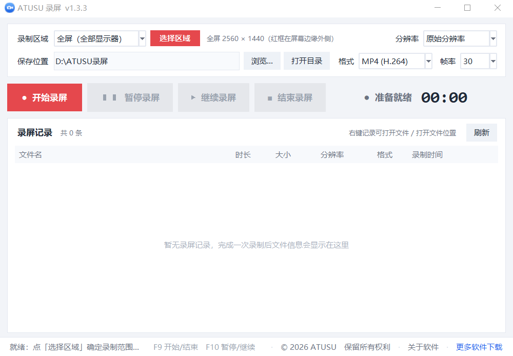
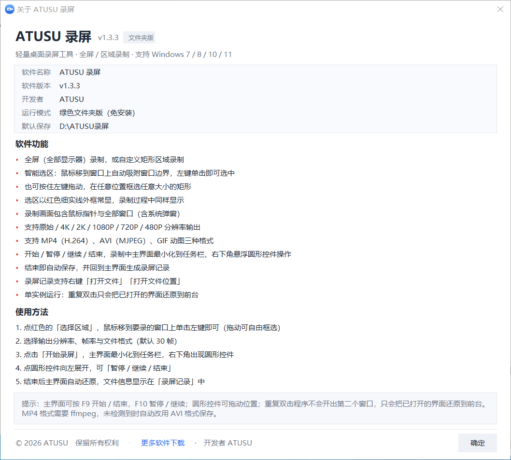

# ATUSU 录屏

**ATUSU Screen Recorder** — 一个用纯 Python + Win32 API 写的轻量 Windows 桌面录屏工具。
打开界面就是录制操作区，选好范围点「开始录屏」即可；录制中主界面最小化到任务栏，屏幕右下角出现
圆形计时控件（一直显示到结束）；结束后自动保存并回到主界面，在下方列表里生成一条录屏记录。

支持 **Windows 7 / 8 / 10 / 11**，全屏与自定义区域、多分辨率、多格式，
**录像包含鼠标指针与全部窗口**（含系统弹窗），选区以红色细实线外框常显。

[](LICENSE)
[](https://www.python.org/)
[](#兼容性)

- 开发者：**ATUSU**
- 官网 / 更多软件下载：**atusu.cn/so**
- 版权：**© 2026 ATUSU　保留所有权利**

---

## 目录

- [特性](#特性)
- [界面一览](#界面一览)
- [快速开始](#快速开始)
- [使用说明](#使用说明)
  - [智能选区（v1.3 新增）](#智能选区v13-新增)
  - [录制流程](#录制流程)
  - [录屏记录](#录屏记录)
  - [快捷键](#快捷键)
- [输出格式与保存位置](#输出格式与保存位置)
- [技术实现](#技术实现)
- [项目结构](#项目结构)
- [从源码构建](#从源码构建)
- [兼容性](#兼容性)
- [常见问题](#常见问题)
- [参与贡献](#参与贡献)
- [版本历史](#版本历史)
- [许可](#许可)

---

## 特性

| 能力 | 说明 |
| --- | --- |
| 全屏录制 | 录制整个桌面；多显示器时为所有显示器拼合的完整画面 |
| 区域录制 | 屏幕变暗后自由框选任意矩形，红色细实线外框 + 加长四角 |
| **智能选区** | 鼠标移到窗口上自动吸附该窗口的可见边界，**左键单击即选中**；不单击、直接拖动则退回自由框选 |
| 选区常显 | 待机与录制中都显示红色实线外框；贴屏幕边时自动画在边内侧 |
| 鼠标指针 | 录像包含鼠标指针，点击、拖动、系统弹窗、通知都如实记录 |
| 多分辨率 | 原始 / 2160P(4K) / 1440P(2K) / 1080P / 720P / 480P，只缩小不放大，宽高自动取偶数 |
| 多格式 | MP4（H.264）、AVI（MJPEG）、GIF 动图；帧率 60 / 30 / 24 / 15 / 10 |
| 录制控制 | 开始 / 暂停 / 继续 / 结束；暂停期间不计入视频时长 |
| 悬浮控件 | 录制中主界面**最小化到任务栏**，**右下角**圆形控件显示时长（距右边 20px、距任务栏 20px），点击**向左展开圆弧操作区**（暂停 / 继续 / 结束），可拖动 |
| 单实例 | 只能开一个窗口；重复双击会把已打开的界面还原到前台（录制中也能唤回） |
| 自动保存 | 结束即保存，文件名形如 `录屏_20261113_203641.mp4` |
| 录屏记录 | 文件名、时长、大小、分辨率、格式、录制时间；重启后仍在 |
| 关于软件 | 底部状态栏进入：软件信息、功能清单、使用方法、版权 |

---

## 界面一览

主界面（打开即是操作区，无标题栏、无实时预览窗）：



关于窗口（软件信息 / 功能 / 使用说明 / 版权）：



悬浮控件（圆形计时 → 点击向左展开操作区；红=录制中，琥珀=已暂停）：

| 收起 | 展开 | 已暂停 |
| --- | --- | --- |
|  |  |  |

> 悬浮控件用 Pillow 以 3 倍超采样绘制，再通过 `UpdateLayeredWindow` 推送到逐像素透明窗口，
> 圆弧与文字都没有锯齿。

---

## 快速开始

### 三个发行版

| 版本 | 文件 | 体积 | 特点 |
| --- | --- | --- | --- |
| 文件夹版 | `dist\ATUSU录屏\ATUSU录屏.exe` | ~145 MB | 内置 ffmpeg，MP4 / AVI / GIF 全可用，启动最快 |
| 单文件版 | `dist\单文件版\ATUSU录屏_单文件版.exe` | ~17 MB | 单个 exe 免安装，内置 AVI / GIF 编码 |
| 整合版 | `dist\单文件版\ATUSU录屏_整合版.exe` | ~56 MB | 单个 exe，**已内置 ffmpeg**，可直接输出 MP4 |

- **文件夹版**：整个 `ATUSU录屏` 文件夹一起拷贝（`_internal` 是运行库，`ffmpeg` 是编码器）。
- **单文件版**：只有一个 exe，双击即用；需要 MP4 时把 `ffmpeg.exe` 放到 exe 旁边。
- **整合版**：一个 exe 全搞定，无需任何外部程序（首次启动解包稍慢几秒）。

### 源码运行

```bat
git clone https://github.com/atusu/atusu-recorder.git
cd atusuRecorder
pip install -r requirements.txt
python app.py            :: 或双击 启动录屏.bat
```

其他入口：

```bat
python app_onefile.py    :: 单文件模式（默认保存到 D:\ATUSU录屏）
python app_packed.py     :: 整合版模式（内置 ffmpeg 路径）
```

> Windows 7 请使用 Python 3.8（3.9 起官方不再支持 Win7），源码完全兼容。

---

## 使用说明

### 智能选区（v1.3 新增）

点红色的「选择区域」后：

1. **自动识别**：鼠标在屏幕上移动时，程序按 z 序拾取光标下最上层的可见窗口，
   框选提示自动贴合该窗口的**可见边界**（用 DWM 扩展边框，去掉 Win10/11 隐藏的阴影留白），
   并在框旁显示 `窗口标题  宽 × 高  ·  左键确认`。
2. **单击确认**：在识别到的窗口上**单击左键**，直接以该窗口为录制范围。
3. **自由框选**：如果不想录整个窗口，**按住左键拖动**即可脱离吸附，在任意位置拉出任意大小的矩形；
   拖动过程中顶部提示会变成「正在框选 · 松开左键确认」。
4. `Esc` 或右键取消。

跳过的窗口：桌面 / 任务栏 / 输入法候选框（Shell 类窗口）、不可见窗口、最小化窗口、
UWP 幽灵窗口（`DWMWA_CLOAKED`）、工具窗口（`WS_EX_TOOLWINDOW`）、以及程序自身。

### 录制流程

1. **打开软件**：屏幕上立即出现红色实线选区外框，标示将要录制的范围。
2. **选择区域**：按上面的智能选区操作，或下拉框选「全屏（全部显示器）」。
3. **设置参数**：分辨率、格式、帧率（默认原始分辨率 / MP4 / 30 帧）、保存位置。
4. **开始录制**：主界面**最小化到任务栏**（图标保留，随时能点回来），**屏幕右下角**出现圆形控件
   （圆内为录制时长，距屏幕右边 20px、距任务栏上沿 20px）。控件是独立窗口，**从开始到结束
   一直显示**，不会自己消失。
5. **操作**：单击圆形 → 控件**以圆形为基点向左展开**一个带同色底、左端圆弧的胶囊操作区，
   内有「暂停 / 结束」两个带图标的白色按钮；暂停后自动变成「继续 / 结束」。按住可拖动位置。
6. **结束**：点「结束」→ 自动保存 → 主界面从任务栏还原并置前，新记录出现在列表首行。

> 录制期间再双击一次程序，不会开出第二个窗口，而是把已最小化的界面还原到前台。

### 录屏记录

列表显示 `文件名 / 时长 / 大小 / 分辨率 / 格式 / 录制时间`，文件被删除的记录会变灰显示「已丢失」。
右侧滚动条为自绘的细圆角样式，**只有记录超出显示区域时才会出现**，没有记录时列表是干净的。

| 操作 | 方式 |
| --- | --- |
| 播放 | 双击记录 |
| 打开文件 / 打开文件位置 | 右键菜单 |
| 复制文件路径 / 从列表移除 / 删除文件 | 右键菜单（删除文件需二次确认） |
| 刷新 | 列表右上角「刷新」 |

### 快捷键

> 主界面处于激活状态时有效。

- `F9`：开始录制 / 结束录制
- `F10`：暂停录制 / 继续录制

---

## 输出格式与保存位置

| 格式 | 编码 | 依赖 | 体积参考（1080P） | 适用 |
| --- | --- | --- | --- | --- |
| MP4 | H.264（libx264, crf 23, `+faststart`） | ffmpeg | 约 1–3 MB / 10 秒 | 分享、存档（推荐） |
| AVI | MJPEG（内置封装器） | 无 | 约 8–15 MB / 秒 | 没有 ffmpeg 时兜底，Windows 播放器可直接播放 |
| GIF | 调色板动图 | 无 | 自动降到宽 720、最高 12 帧 | 表情包、短演示 |

默认保存目录：

| 版本 | 默认目录 |
| --- | --- |
| 文件夹版 | `C:\Users\<用户名>\Videos\ATUSU录屏` |
| 单文件版 / 整合版 | `D:\ATUSU录屏`（无 D 盘则 E 盘…；只有 C 盘则 `C:\ATUSU录屏`） |

配置与记录：`%APPDATA%\atusuRecorder\settings.json`、`records.json`。

---

## 技术实现

### 1. 屏幕采集（`engine.GdiGrabber`）

`BitBlt`（`SRCCOPY`）把屏幕位图拷到内存 DC，再用 `GetDIBits` 取 32 位 `BGRX` 原始像素，
交给 Pillow 组装成 `RGB` 图像。相比 `ImageGrab` 每次重新建 DC，复用 DC/位图后单帧约 18 ms；
失败自动回退 `PIL.ImageGrab`（`all_screens=True`）。

鼠标指针由 `GetCursorInfo` + `DrawIconEx` 直接画到内存 DC 上：`DrawIconEx` 以左上角定位，
所以绘制点要用「光标坐标 − 热点」，热点通过 `GetIconInfo` 读取并缓存。

### 2. 编码

- **MP4**：把 `rgb24` 原始帧通过管道喂给 ffmpeg（`-f rawvideo`），x264 `veryfast`/crf 23 实时编码。
- **AVI**：自写 RIFF/MJPG 封装器（`avih`/`strh`/`strf` + `movi` + `idx1`），不依赖任何外部程序。
- **GIF**：录制期把帧降采样存为 JPEG 暂存，结束时统一合成调色板动图，控制内存占用。

### 3. 悬浮控件（`floatwin` + `overlayui`）

**绘制**（`overlayui`）：Tk 的 Canvas 不做抗锯齿，小尺寸圆形会有明显阶梯边，所以控件
先用 Pillow 以 **3 倍超采样**画渐变胶囊、白色圆环、图标与文字，再
`Image.resize(..., LANCZOS)` 缩到目标尺寸，得到逐像素平滑的 RGBA 图。

**窗口**（`floatwin`）：录制中的控件必须「一开始就出现、只有结束才消失」，所以它不能是
Tk 窗口——Tk 的 `Toplevel` 属于 Tk 的窗口树，主窗口最小化 / 隐藏 / 重绘时会被连带处理，
这正是早期版本「闪一下就没了」的根源。现在改用 `CreateWindowExW` 建一块**独立**的分层窗口：

| 样式 | 作用 |
| --- | --- |
| `WS_EX_LAYERED` | 配合 `UpdateLayeredWindow` 推送 alpha 位图，逐像素半透明 |
| `WS_EX_TOPMOST` | 始终置顶（并每 700ms 复位一次，防止被后来的置顶窗口压住） |
| `WS_EX_TOOLWINDOW` | 不出现在任务栏与 Alt+Tab |
| `WS_EX_NOACTIVATE` | 点击不抢焦点，不打断正在被录制的软件 |

生命周期只有两条路径：`_start()` 创建显示、`_stop()` / 退出程序销毁。中间**不存在任何
隐藏逻辑**，另外还有一个看门定时器兜底：窗口被系统回收就原地重建，被压住就复位置顶。

**输入**改为轮询而不是窗口回调：每 16ms 读一次 `GetCursorPos` 与 `GetAsyncKeyState`，
自己判断「是否在控件内、是否按下、是否拖动」。这样既没有 ctypes 的 `WNDPROC` 回调
（它会在录制线程 `ctypes` 释放 GIL 期间与主线程来回切 GIL，实测会偶发
`PyEval_RestoreThread` 致命错误让进程直接退出），逻辑也更直观。

### 4. 不把控件录进画面

选区红框是普通 Tk 窗口，可以用
`SetWindowDisplayAffinity(hwnd, WDA_EXCLUDEFROMCAPTURE)`（Windows 10 2004+）标记为
「不参与屏幕捕获」，`BitBlt` 同样生效，所以录像里看不到红边。

悬浮控件是 `UpdateLayeredWindow` 的分层窗口，这个 API 在分层窗口上会返回
`ERROR_NOT_ENOUGH_MEMORY` 而无法生效（Windows 的已知限制），因此**全屏录制时控件可能出现在
录像画面右侧**。规避方式：选择「自定义区域」录制并把区域避开控件所在位置（控件可用鼠标拖动到
任意角落）。

### 5. 智能选区（`engine.pick_window`）

`EnumWindows` 按 z 序自上而下遍历顶层窗口，逐个过滤：可见、未最小化、非本进程、
无 `WS_EX_TOOLWINDOW`、有标题、非 Shell 类窗口、未被 DWM cloak，然后用
`DwmGetWindowAttribute(DWMWA_EXTENDED_FRAME_BOUNDS)` 取「看起来的」边界（Win7 回退
`GetWindowRect`），与虚拟屏幕求交后取第一个包含鼠标点的窗口。

### 6. 单实例与录制期的窗口状态

- **单实例**：启动时 `CreateMutexW` 抢占一个命名互斥体，`GetLastError() == 183`
  说明已有实例；此时枚举窗口找到它的主窗口（最小化状态下窗口矩形会被挪到
  `(-32000, -32000)`，所以不能靠尺寸判断，要单独用 `IsIconic` 识别），
  `ShowWindow(SW_RESTORE)` 后用 `AttachThreadInput` 绕过前台限制把它置前。
- **录制时最小化而不是隐藏**：`withdraw` 会让任务栏图标消失，并且会连带隐藏它拥有的
  悬浮控件；改用 `iconify()` + `ShowWindow(SW_MINIMIZE)`，图标保留，控件正常显示。
- **悬浮控件不用 Tk 窗口**：`Toplevel` 属于 Tk 的窗口树，主窗口最小化 / 隐藏时会被系统
  一起处理掉。控件改由 `CreateWindowExW` 创建一块独立的分层窗口（见下一节），与主界面
  没有任何父子 / owner 关系。

---

## 项目结构

```

├── app.py                  # 主界面与交互（tkinter）
├── engine.py               # 采集 / 编码 / 智能选区 / 配置存储
├── overlayui.py            # 悬浮控件渲染（Pillow 3 倍超采样 → RGBA 图）
├── floatwin.py             # 悬浮控件的原生窗口（CreateWindowExW + UpdateLayeredWindow）
├── app_onefile.py          # 单文件版入口
├── app_packed.py           # 整合版入口（内置 ffmpeg）
├── atusu.ico               # 程序图标
├── requirements.txt        # 运行依赖（Pillow）
├── ffmpeg/ffmpeg.exe       # MP4 编码器 （自行下载放进去）
├── docs/screenshots/       # README 截图
├── README.md
├── LICENSE
├── .gitignore
└── .gitattributes

```

---


## 兼容性

| 系统 | 状态 | 说明 |
| --- | --- | --- |
| Windows 11 | ✅ 完整支持 | 红框不进入录像（分层控件见「已知限制」） |
| Windows 10 2004+ | ✅ 完整支持 | 同上（`WDA_EXCLUDEFROMCAPTURE` 生效） |
| Windows 10 早期 / 8.1 / 8 | ✅ 可用 | 录制中红框自动移到选区外侧 |
| Windows 7 | ✅ 可用 | 需 Python 3.8 构建；无 DWM 扩展边框，用 `GetWindowRect` |

已知限制：

- UAC 安全桌面、锁屏密码界面无法录制（系统不允许普通进程访问）。
- AVI（MJPEG）只做帧内压缩，体积较大；长时间录制建议用 MP4。
- 高 DPI 缩放已做 per-monitor 适配，混用不同缩放比例的显示器也能正确取坐标。
- 悬浮控件是 `UpdateLayeredWindow` 分层窗口，无法设置 `WDA_EXCLUDEFROMCAPTURE`，
  全屏录制时可能出现在录像里（详见「不把控件录进画面」）。

---

## 常见问题

**Q：外框和圆形控件会被录进视频吗？**

选区红框不会：它被标记为「不参与屏幕捕获」。圆形控件是逐像素透明的分层窗口，Windows 不允许
这类窗口设置同样的标记，所以**全屏录制时控件可能出现在画面右侧**；用「自定义区域」录制并把
区域避开控件位置即可（控件可以拖到任意角落）。

**Q：为什么选了 MP4 却保存成 AVI？**

MP4 需要 ffmpeg。程序按 `内置 → 程序目录 → 系统 PATH` 查找，找不到就自动改用 AVI 并在状态栏提示。

**Q：三个版本怎么选？**

想一个文件拷走就走 → 整合版（内置 ffmpeg，能出 MP4）；要体积最小 → 单文件版（AVI/GIF）；
要启动最快、功能最全 → 文件夹版。

**Q：能录到系统弹窗、右键菜单、通知吗？**

能，按屏幕像素抓取，正在显示的内容都会进入画面（UAC 安全桌面除外）。

**Q：多显示器 / 负坐标副屏能用吗？**

能。区域选择覆盖整个虚拟桌面，可分别框选每个显示器。

**Q：杀毒软件提示风险？**

打包产物由 PyInstaller 生成，未签名 exe 常被误报，添加信任即可；也可以直接用源码运行。

---


## 许可

本项目使用 [MIT License](LICENSE) 开源。

```
Copyright (c) 2026 ATUSU
```

第三方组件：

- [Pillow](https://python-pillow.org/) — MIT-CMU License
- [FFmpeg](https://ffmpeg.org/) — LGPL / GPL（整合版内置 ffmpeg.exe，遵循其原始许可）

---

© 2026 ATUSU　保留所有权利　·　开发者 ATUSU　·　更多软件下载 atusu.cn/so
